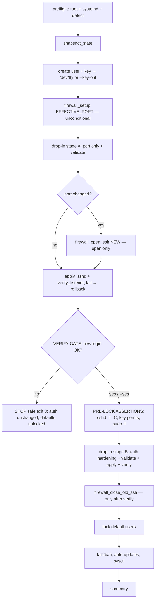

# Phase 4: Orchestrator — lock-safe flow + idempotency

## Overview
`vps-hardening.sh`: parse flags, source lib/*, sắp xếp thứ tự an toàn tuyệt đối (two-stage SSH: port trước, auth-hardening SAU verify gate), gate xác nhận + pre-lock assertions trước khi lock user mặc định. Đây là nơi duy nhất quyết định thứ tự — lib không tự gọi nhau.

## Requirements
- Functional:
  - Flags: `--user NAME` (bắt buộc, hoặc prompt), `--port N` (optional), `--yes` (skip confirm — automation, in cảnh báo rõ), `--key-out PATH` (ghi private key ra file chmod 600 thay vì chỉ in — đường an toàn cho automation), `--rotate-key` (tái sinh + cài lại + in lại key), `--skip-firewall`, `--skip-fail2ban`, `--skip-updates`, `--skip-sysctl`, `--help`.
  - Flow bắt buộc theo thứ tự:
    1. preflight: root check, **systemd check** (`[[ -d /run/systemd/system ]]` else die), source detect.sh, in bảng detection (distro, family, unit, socket, selinux)
    2. `snapshot_state` (drop-in cũ + firewall SSH rules)
    3. create_admin_user + install_user_key → **in private key ra `/dev/tty` (không stdout/log)** hoặc ghi `--key-out`; yêu cầu xác nhận "đã lưu key" (trừ --yes). Nếu key đã cài từ run trước mà gate chưa từng confirm → bắt buộc `--rotate-key` hoặc từ chối tiếp tục (tránh skip âm thầm khi không ai giữ key)
    4. `firewall_setup EFFECTIVE_PORT` — **vô điều kiện** (run không --port vẫn có firewall)
    5. write_dropin **stage A** (chỉ port) + validate_sshd
    6. Nếu đổi port: `firewall_open_ssh NEW_PORT` (chỉ MỞ, chưa đóng gì)
    7. `apply_sshd` + `verify_listener` (fail → `rollback_state` + die)
    8. **VERIFY GATE**: in lệnh test chính xác `ssh -i <key> -p <port> <user>@<host>` + `sudo true`; prompt "Đã login được bằng phiên MỚI? [y/N]".
       - `--yes` → skip human prompt NHƯNG vẫn chạy **pre-lock assertions** (bước 9).
       - Không confirm → dừng an toàn (exit 3): auth-hardening chưa apply, password auth còn sống, user mặc định chưa lock → đường cũ còn nguyên. In trạng thái + lệnh resume.
    9. **PRE-LOCK ASSERTIONS (cả hai path, kể cả --yes):** `sshd -T -C user=<new>,host=localhost,addr=127.0.0.1` có `pubkeyauthentication yes` + `passwordauthentication no`; authorized_keys tồn tại, perms/owner đúng (`stat`); `sudo -l -U NAME` non-empty; `su - NAME -c true` OK. Fail → die, không lock gì.
    10. write_dropin **stage B** (auth-hardening) + validate + apply + verify_listener (fail → rollback + die)
    11. Nếu đổi port: `firewall_close_old_ssh NEW_PORT` (đóng port cũ — chỉ sau khi port mới chứng minh hoạt động)
    12. `lock_default_users`
    13. setup_fail2ban, setup_auto_updates, setup_sysctl (theo skip flags)
    14. Summary: trạng thái từng thành phần, nhắc private key, link recovery.
  - Idempotency: mọi bước check-trước-ghi; effective port derive từ live config (không revert port cũ khi flagless re-run); chạy lần 2 exit 0, báo "already done" từng bước.
  - Logging: tee ra `/var/log/vps-hardening-<timestamp>.log` (umask 077). **Private key KHÔNG BAO GIỜ qua fd 1/2** — chỉ `/dev/tty` hoặc `--key-out` file. Phase 5 có grep test assert log không chứa "PRIVATE KEY".
- Non-functional: `set -euo pipefail`; trap cleanup file tạm + `rollback_state` khi fail sau mutation; orchestrator < 200 LOC (đã modular ở lib).

## Architecture

## Related Code Files
- Create: `vps-hardening.sh`

## Implementation Steps
1. Flag parsing (while/case, không getopt phức tạp).
2. Source lib theo thứ tự logging → detect → user → sshd → firewall → services.
3. Wire flow theo mermaid; gate ở bước 8; pre-lock assertions bước 9.
4. Key output: `/dev/tty` print hoặc `--key-out`; log tee bắt đầu SAU khi key đã in (hoặc key in qua /dev/tty để tee không bắt được — chọn /dev/tty làm cơ chế chính).
5. Idempotency: tái dùng check trong lib; effective port từ live config.
6. Chạy end-to-end trong container ubuntu:24.04 với --yes; kiểm log không chứa private key.

## Success Criteria
- [x] `--help` đầy đủ; thiếu `--user` → usage + exit 2
- [x] Không phải systemd → die rõ "unsupported environment"
- [x] Run mặc định (không `--port`): firewall vẫn được setup + enable
- [x] Gate decline (trả lời n): script dừng exit 3, password auth còn nguyên, user mặc định chưa lock (đường cũ sống)
- [x] `--yes`: pre-lock assertions vẫn chạy; fail → không lock
- [x] Key đã cài + gate chưa confirm + không `--rotate-key` → từ chối tiếp tục với hướng dẫn rõ
- [x] Full run --yes trên container: mọi acceptance phase 1-3 đạt
- [x] Chạy lần 2: exit 0, "already done", custom port không bị revert
- [x] Log file không chứa private key (grep "PRIVATE KEY" empty)

## Risk Assessment
- Operator bấm y mà chưa thật sự login được → pre-lock assertions (bước 9) là machine-check bổ sung; không loại bỏ hoàn toàn rủi ro người dùng nói dối gate — README nhấn giữ phiên hiện tại mở + recovery qua console.
- Private key qua /dev/tty: khi chạy không có TTY (cloud-init) và không --key-out → die với message yêu cầu --key-out (không fallback in stdout).
- Rollback không khôi phục được mọi thứ (sysctl đã apply...) → snapshot giới hạn ở sshd drop-in + firewall rules (đường lockout); sysctl/fail2ban chạy sau gate, fail chỉ warn.
